# Bài thực hành 03 - Ứng dụng chat (React Native)

Sinh viên: **Phạm Đức Anh** - PTIT, Công nghệ phần mềm. Ứng dụng chat 5 màn hình theo đề (Đăng nhập, Home, Danh bạ, Thông báo, Cài đặt) và màn chi tiết cuộc trò chuyện.

## Minh chứng các màn hình

Ảnh chụp từ máy ảo Android (Pixel 8 Pro), lưu trong `docs/screenshots/`.

### 1. Đăng nhập

Hiển thị tên ứng dụng, ô tài khoản, ô mật khẩu và nút Đăng nhập. Nhập đúng `demo` / `123456` thì chuyển sang Home.

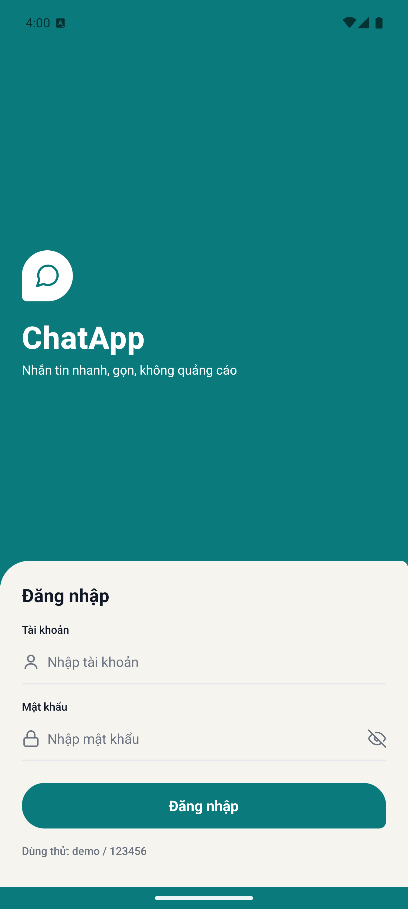

### 2. Home - danh sách cuộc trò chuyện

Mỗi dòng có ảnh đại diện, tên, tin nhắn gần nhất, thời gian và số tin chưa đọc. Có ô tìm kiếm cuộc trò chuyện. Danh sách cuộn được. Nhấn một dòng để mở nội dung chat.

| Danh sách                                              | Cuộn xuống                                                           | Tìm kiếm "Linh"                                                        |
| ------------------------------------------------------ | -------------------------------------------------------------------- | ---------------------------------------------------------------------- |
| 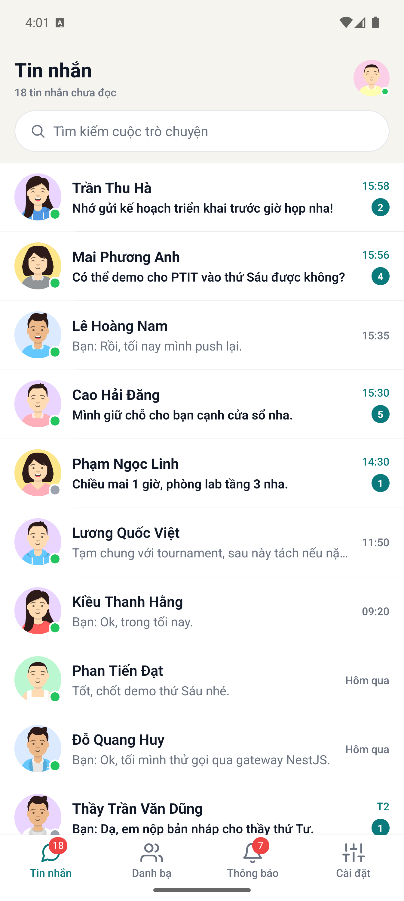 | 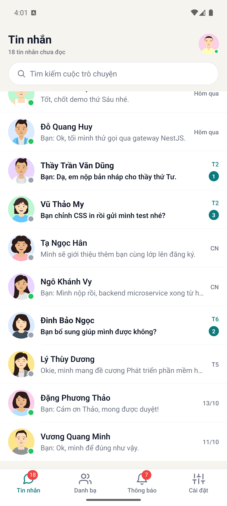 | 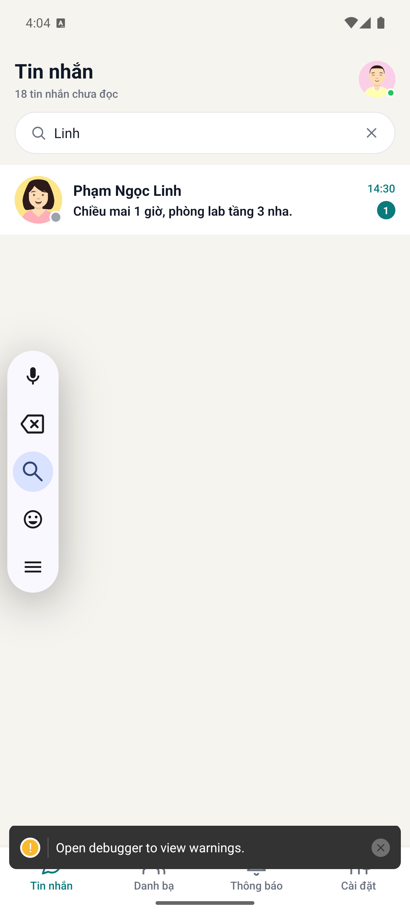 |

### 3. Chi tiết cuộc trò chuyện

Xem tin nhắn hai bên, nhập và gửi tin mới. Quay lại Home thì dòng cuộc trò chuyện hiện tin vừa gửi (`Bạn: ...`).

| Nội dung chat                                                 | Đang nhập                                                                      | Đã gửi                                                               | Home cập nhật                                                                      |
| ------------------------------------------------------------- | ------------------------------------------------------------------------------ | -------------------------------------------------------------------- | ---------------------------------------------------------------------------------- |
| 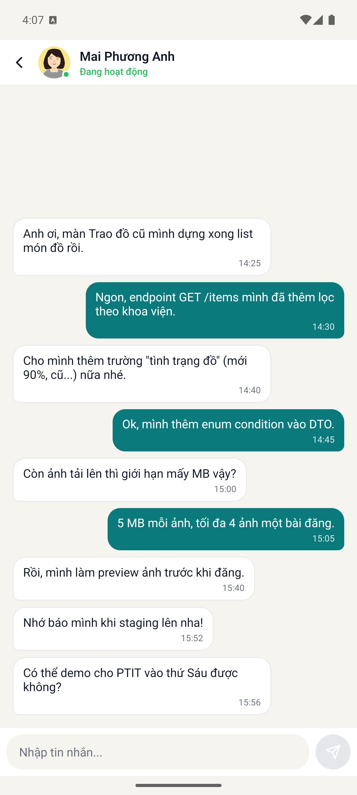 | 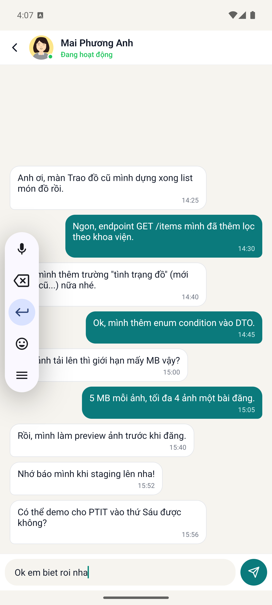 | 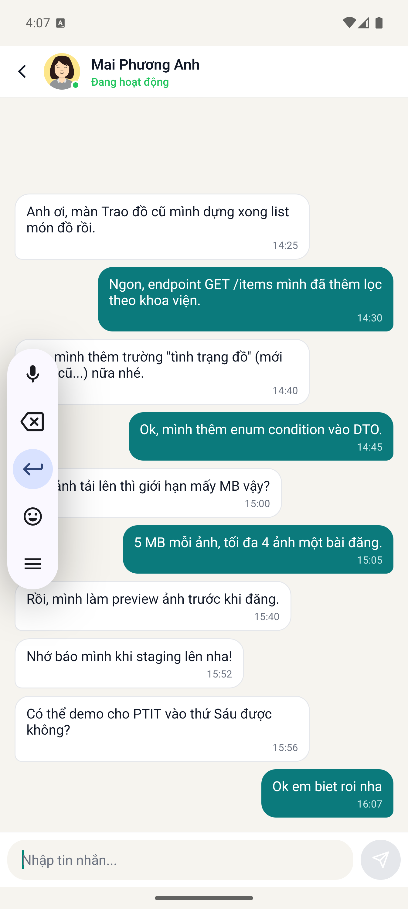 | 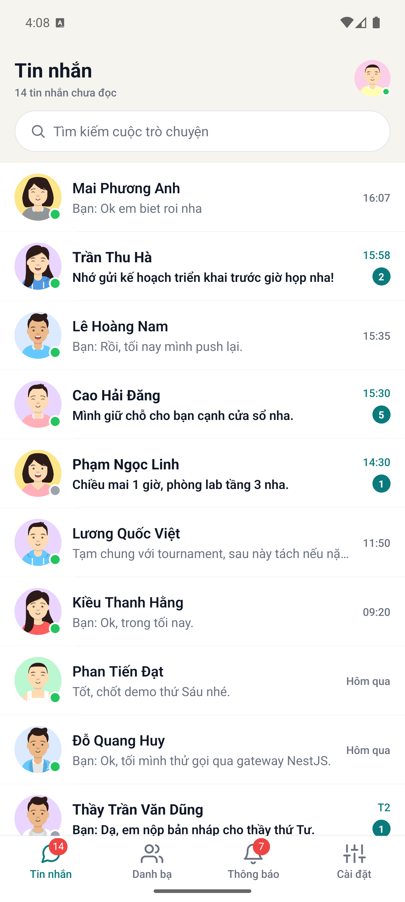 |

### 4. Danh bạ

Danh sách người dùng gồm ảnh đại diện, tên và trạng thái trực tuyến. Có tìm kiếm danh bạ. Nhấn một người để mở cuộc trò chuyện tương ứng.

| Danh bạ                                                    | Tìm kiếm "Nam"                                                             | Mở chat từ danh bạ                                                                   |
| ---------------------------------------------------------- | -------------------------------------------------------------------------- | ------------------------------------------------------------------------------------ |
| 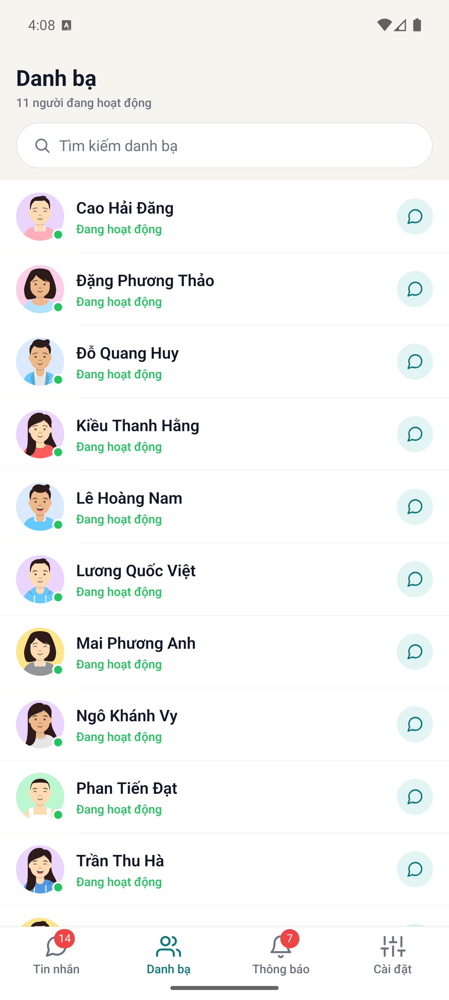 | 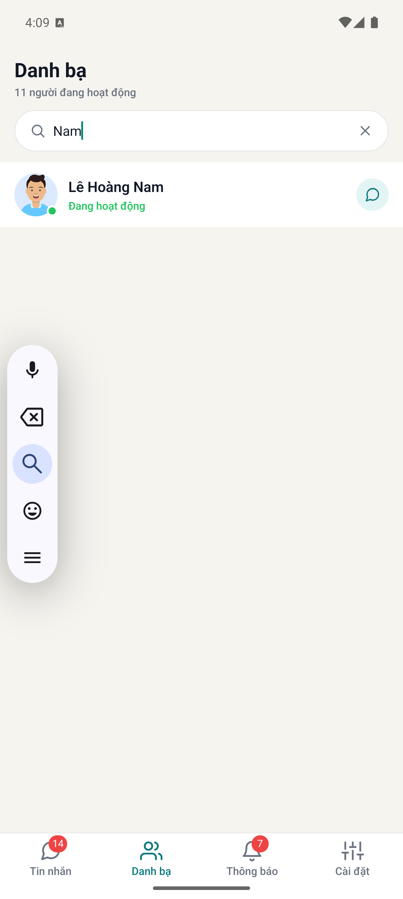 | 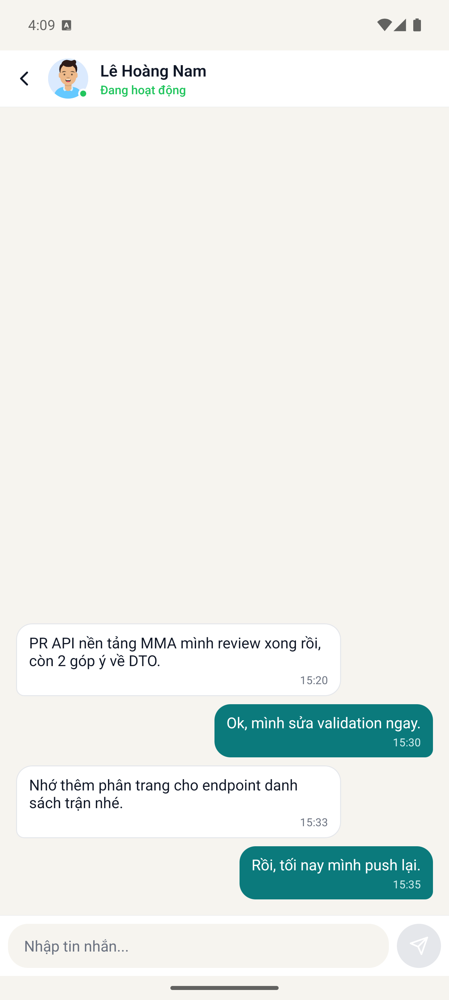 |

### 5. Thông báo

Mỗi thông báo có nội dung, thời gian và trạng thái đã đọc/chưa đọc. Thông báo chưa đọc có nền và chấm màu riêng. Nhấn một thông báo để đánh dấu đã đọc, hoặc dùng "Đọc tất cả". Số chưa đọc ở tiêu đề và huy hiệu tab giảm theo.

| Ban đầu (7 chưa đọc)                                            | Đánh dấu 1 tin (còn 6)                                                                | Đọc tất cả (còn 0)                                                                |
| --------------------------------------------------------------- | ------------------------------------------------------------------------------------- | --------------------------------------------------------------------------------- |
| 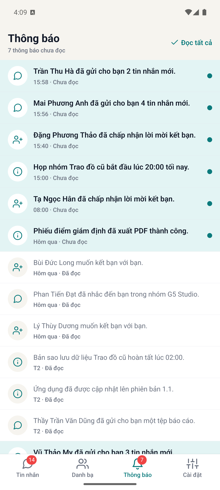 | 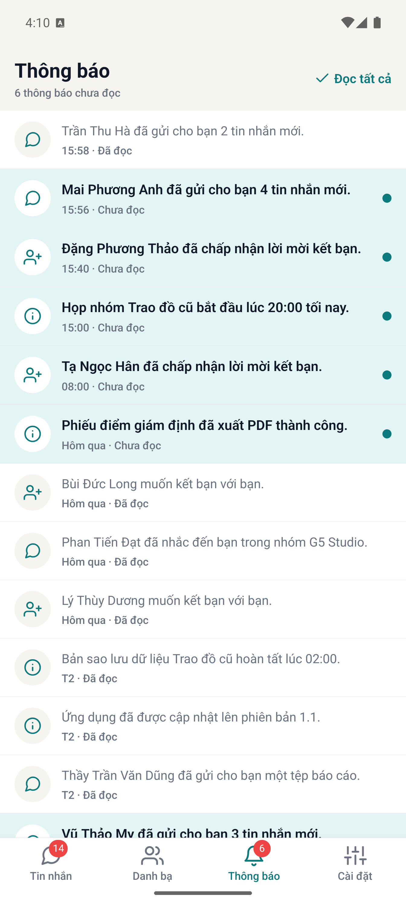 | 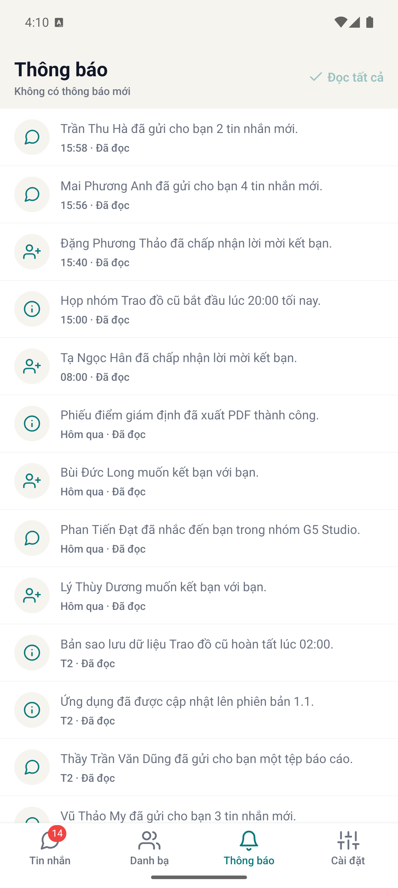 |

### 6. Cài đặt

Hiển thị thông tin tài khoản (Phạm Đức Anh, `@demo`, email). Hai công tắc `Switch`: "Hiển thị trạng thái online" (đổi dòng trạng thái thành "Đang ẩn trạng thái") và "Nhận thông báo". Nút Đăng xuất hỏi xác nhận rồi quay về màn Đăng nhập.

| Cài đặt                                                    | Tắt trạng thái online                                                        | Tắt nhận thông báo                                                                   | Xác nhận đăng xuất                                                                    | Về Đăng nhập                                                                   |
| ---------------------------------------------------------- | ---------------------------------------------------------------------------- | ------------------------------------------------------------------------------------ | ------------------------------------------------------------------------------------- | ------------------------------------------------------------------------------ |
| 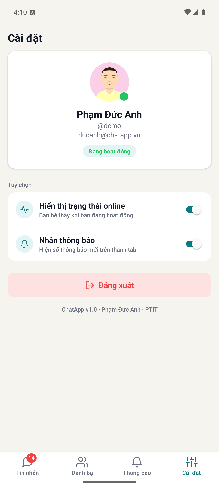 | 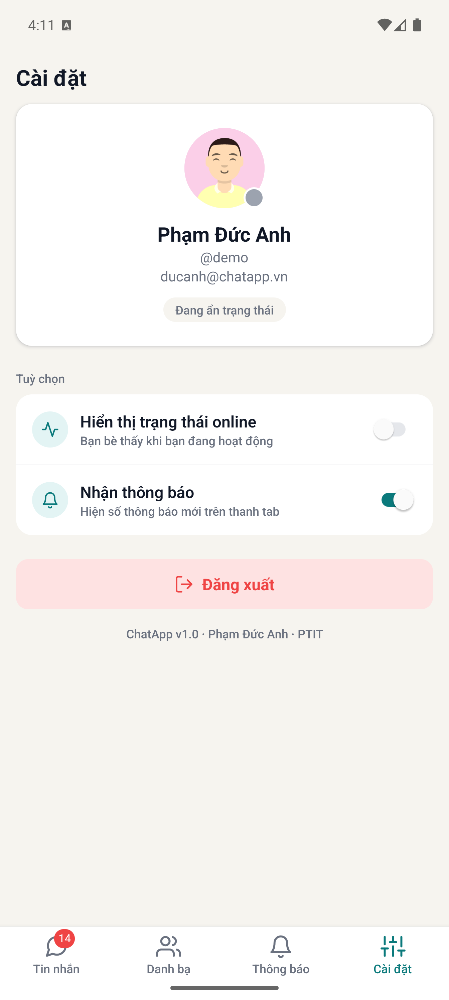 | 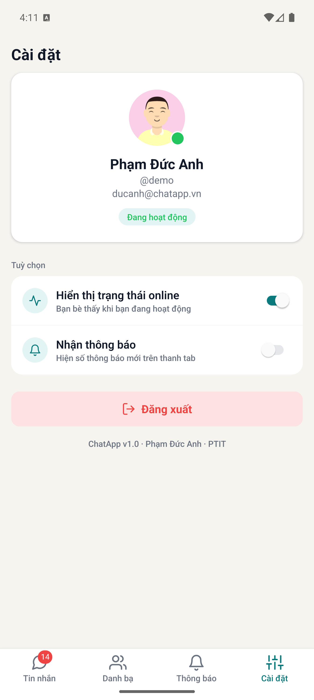 | 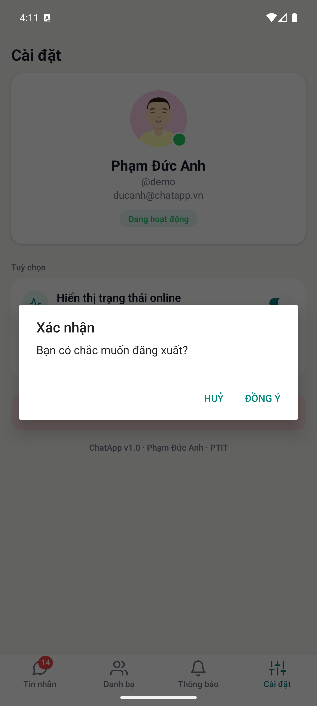 | 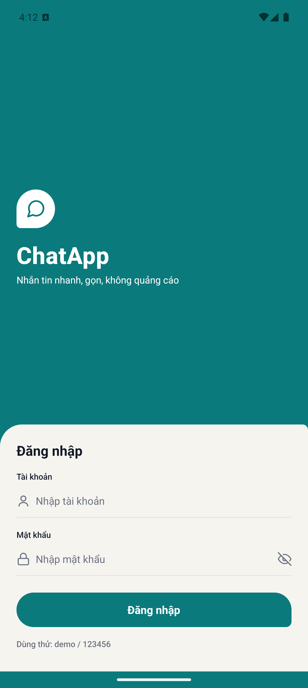 |

## Chạy ứng dụng

```sh
npm install
npx react-native start --port 8082
# mở terminal khác, máy ảo Android đang bật
npx react-native run-android --port 8082 --no-packager
```

Tài khoản demo: `demo` / `123456`.

## Công nghệ và cấu trúc

| Hạng mục              | Nội dung                                                                                    |
| --------------------- | ------------------------------------------------------------------------------------------- |
| Điều hướng            | `@react-navigation/native`, `native-stack` (Login, Main, ChatDetail), `bottom-tabs` (4 tab) |
| Component cơ bản      | View, Text, TextInput, Image, TouchableOpacity, FlatList, Switch                            |
| Trạng thái dùng chung | React Context: `AuthContext`, `ChatContext`, `NotificationContext`                          |
| Dữ liệu               | Dữ liệu mẫu trong `src/data`: 20 người dùng, 17 cuộc trò chuyện, 16 thông báo               |

```text
src/
  navigation/   RootNavigator, MainTabs, types
  features/     auth, chats, contacts, notifications, settings (mỗi màn có components riêng)
  components/   Avatar, SearchBar, ScreenHeader, EmptyState, Icon
  context/      AuthContext, ChatContext, NotificationContext
  data/ types/ theme/ utils/
```

---

# Hướng dẫn mặc định của React Native

This is a new [**React Native**](https://reactnative.dev) project, bootstrapped using [`@react-native-community/cli`](https://github.com/react-native-community/cli).

# Getting Started

> **Note**: Make sure you have completed the [Set Up Your Environment](https://reactnative.dev/docs/set-up-your-environment) guide before proceeding.

## Step 1: Start Metro

First, you will need to run **Metro**, the JavaScript build tool for React Native.

To start the Metro dev server, run the following command from the root of your React Native project:

```sh
# Using npm
npm start

# OR using Yarn
yarn start
```

## Step 2: Build and run your app

With Metro running, open a new terminal window/pane from the root of your React Native project, and use one of the following commands to build and run your Android or iOS app:

### Android

```sh
# Using npm
npm run android

# OR using Yarn
yarn android
```

### iOS

For iOS, remember to install CocoaPods dependencies (this only needs to be run on first clone or after updating native deps).

The first time you create a new project, run the Ruby bundler to install CocoaPods itself:

```sh
bundle install
```

Then, and every time you update your native dependencies, run:

```sh
bundle exec pod install
```

For more information, please visit [CocoaPods Getting Started guide](https://guides.cocoapods.org/using/getting-started.html).

```sh
# Using npm
npm run ios

# OR using Yarn
yarn ios
```

If everything is set up correctly, you should see your new app running in the Android Emulator, iOS Simulator, or your connected device.

This is one way to run your app — you can also build it directly from Android Studio or Xcode.

## Step 3: Modify your app

Now that you have successfully run the app, let's make changes!

Open `App.tsx` in your text editor of choice and make some changes. When you save, your app will automatically update and reflect these changes — this is powered by [Fast Refresh](https://reactnative.dev/docs/fast-refresh).

When you want to forcefully reload, for example to reset the state of your app, you can perform a full reload:

- **Android**: Press the <kbd>R</kbd> key twice or select **"Reload"** from the **Dev Menu**, accessed via <kbd>Ctrl</kbd> + <kbd>M</kbd> (Windows/Linux) or <kbd>Cmd ⌘</kbd> + <kbd>M</kbd> (macOS).
- **iOS**: Press <kbd>R</kbd> in iOS Simulator.

## Congratulations! :tada:

You've successfully run and modified your React Native App. :partying_face:

### Now what?

- If you want to add this new React Native code to an existing application, check out the [Integration guide](https://reactnative.dev/docs/integration-with-existing-apps).
- If you're curious to learn more about React Native, check out the [docs](https://reactnative.dev/docs/getting-started).

# Troubleshooting

If you're having issues getting the above steps to work, see the [Troubleshooting](https://reactnative.dev/docs/troubleshooting) page.

# Learn More

To learn more about React Native, take a look at the following resources:

- [React Native Website](https://reactnative.dev) - learn more about React Native.
- [Getting Started](https://reactnative.dev/docs/environment-setup) - an **overview** of React Native and how setup your environment.
- [Learn the Basics](https://reactnative.dev/docs/getting-started) - a **guided tour** of the React Native **basics**.
- [Blog](https://reactnative.dev/blog) - read the latest official React Native **Blog** posts.
- [`@facebook/react-native`](https://github.com/facebook/react-native) - the Open Source; GitHub **repository** for React Native.
